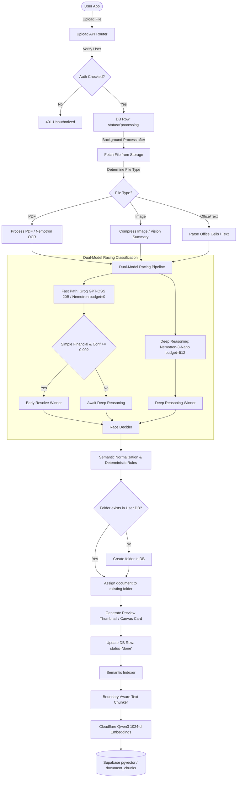
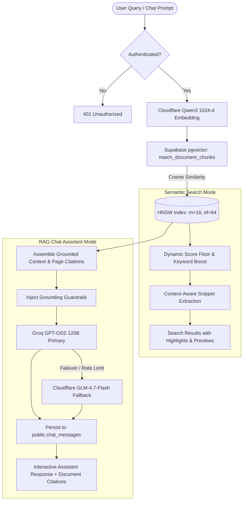

# 📄 PaperWait

<div align="center">

[](LICENSE)
[](https://nextjs.org/)
[](https://react.dev/)
[](https://www.typescriptlang.org/)
[](https://tailwindcss.com/)
[](https://supabase.com/)
[](https://build.nvidia.com/)
[](https://developers.cloudflare.com/workers-ai/)
[](https://groq.com/)

**"Because waiting to find it isn't an option."**

*A high-speed, secure, and AI-powered document intelligence safe featuring autonomous organization, dual-model racing classification, 1024-dimensional semantic vector search, grounded RAG document chat, and multi-format visual card generation.*

### 🌐 [paperwait.me](https://paperwait.me)

### 🎥 [Watch Product Demo](https://drive.google.com/file/d/1K95xMwCEcmCGVs2hF9aCWnMDlrArQdOy/view?usp=sharing)

[Key Features](#-key-features) • [System Architecture](#-system-architecture) • [AI & Search Pipeline](#-ai--search-pipeline) • [Classification Architecture](#-dual-model-racing-classification) • [API Reference](#-api-reference) • [Environment Configuration](#-environment-configuration) • [Database Setup](#-database--storage-setup) • [Security Spec](#-security-specifications)

</div>

---

## 🌟 Key Features

- 🤖 **Ensembled Dual-Model AI Classification & Racing Pipeline**:
  - **Fast Path**: Sub-second transactional classification powered by Groq (`openai/gpt-oss-20b`) with instant failover to NVIDIA Nemotron-3-Nano (`reasoning_budget: 0`).
  - **Deep Reasoning Path**: Context-rich taxonomy inference and entity extraction via NVIDIA Nemotron-3-Nano (`nvidia/nemotron-3-nano-omni-30b-a3b-reasoning`, `reasoning_budget: 512`, `max_tokens: 2048`).
  - **Dynamic Racing Protocol**: Fast path resolves early strictly for simple financial documents (`Receipts`, `Invoices`, `Bills`, `Utilities`, `Tax Documents`) with high confidence ($\ge 0.85$). Complex contextual documents (resumes, job postings, exams, admit cards, government IDs) await deep reasoning to eliminate misclassifications without brittle hardcoding.
  - **Deterministic Semantic Routing & Cross-Category Guards**: Resumes route to `Resume`, JDs to `Job Descriptions`, exams/admit cards/lecture modules to `Education`, government IDs to `Government IDs`, marksheets to `Results`, and vehicle/road tax slips to `Transport Department Jharkhand`. Cross-category guards ensure non-employment documents are never placed in `Job Descriptions` or `Resume`.

- 💬 **Grounded RAG AI Document Assistant & Mobile-First Interface**:
  - Conversational Q&A grounded strictly in the user's private document vault.
  - **Mobile-First Responsive Bottom Sheet**: Dynamically switches between an elegant desktop floating panel (`w-[480px]`) and an iOS/Android native-feeling bottom sheet drawer (`90dvh`, rounded top sheet `rounded-t-3xl`, drag handle bar, touch-to-dismiss backdrop, and hardware safe-area insets `env(safe-area-inset-bottom)`).
  - **Virtual Keyboard & Input Polish**: Prevents iOS Safari auto-zoom via responsive font sizing (`text-base sm:text-sm`), features an auto-growing textarea that expands dynamically up to 120px with smooth momentum scrolling, and maintains viewport focus without jarring layout shifts.
  - **Collision Prevention & Touch Target Optimization**: Relocates background upload indicators to prevent overlapping the chat FAB; incorporates generous WCAG-compliant touch targets ($\ge 44\times 44\text{px}$) for close, clear, copy, and send actions.
  - **Rich Markdown Formatting**: Beautiful native formatting for comparison tables with horizontal momentum scrolling, key-value bullet cards, numbered lists, blockquotes, code blocks with syntax tags and one-click copy, and interactive citation badges.
  - **Accidental Deletion Protection**: Dedicated confirmation dialog modal before purging conversation history on client and server with outside backdrop dismissal.
  - **One-Click Answer Copy**: Instant clipboard copy with visual feedback for generated summaries and document comparisons.
  - **Verifiable Citations**: Direct links with page numbers (e.g., `[Document: tax_return_2025.pdf, Page 2]`) navigating straight to the decrypted page in the document viewer, automatically minimizing the mobile drawer.
  - **Dual-Model Inference**: High-speed primary inference via Groq (`openai/gpt-oss-120b`) with automated failover to Cloudflare Workers AI (`@cf/zai-org/glm-4.7-flash`).
  - **Dual-Layer Persistence**: Synchronized chat history in Supabase (`public.chat_messages`) with Row Level Security (RLS) coupled with zero-latency localStorage client caching.

- 🔍 **1024-Dimensional Vector Semantic Search**:
  - Natural language search across document contents, concepts, and metadata.
  - Powered by Cloudflare Workers AI 1024-dimensional embeddings (`@cf/qwen/qwen3-embedding-0.6b`).
  - Sub-millisecond similarity retrieval powered by PostgreSQL `pgvector` with HNSW cosine indexes (`m=16, ef_construction=64`).
  - Hybrid search architecture: combines vector cosine similarity, title/content keyword boosting, and dynamic precision score filtering.
  - Interactive UI with instant keyword mark highlighting, contextual snippet windows, and thumbnail previews.

- ⚡ **Multi-Format Ingestion & Fast Processing**:
  - Ingests **PDFs**, **Images** (PNG, JPG, JPEG, WebP), **Word documents** (`.docx`/`.doc`), **Excel spreadsheets** (`.xlsx`), **PowerPoint presentations** (`.pptx`/`.ppt`), **CSV**, and **Plain Text** (`.txt`).
  - High-speed digital text extraction via PDF.js with automated fallback to NVIDIA Nemotron OCR NIM for scanned or image-based pages.
  - Boundary-aware text chunking that preserves structural document markers (`--- Page N ---` and `--- Sheet: Name ---`) with strict forward progress and bounded memory execution.
  - Automated background vector indexing triggered immediately upon document ingestion via Next.js `after()`.

- 📁 **Smart Folder Match & Auto-Creation**:
  - Intelligently maps document context to user folder hierarchies.
  - Matches existing folders through case-insensitive normalization, plural/singular compatibility (e.g. `Resume` vs `Resumes`, `Job Description` vs `Job Descriptions`), and Levenshtein typo distance metrics.
  - Auto-provisions organized directories when no existing category matches.

- 🖼️ **On-Demand Visual Previews**:
  - Automatically renders PDF first-page cover previews via server-side Canvas rasterization.
  - Resizes and compresses image thumbnails with aspect ratio preservation.
  - Generates custom high-fidelity SVG/Canvas cards for Word, Excel spreadsheets, PowerPoint slides, and plain text files with server-side font rendering (`@napi-rs/canvas`).

- 🛡️ **Conflict Resolution & Generic File Renaming**:
  - Intelligent conflict detection modal (`Replace` vs `Keep Both`).
  - Automatically renames generic camera captures (e.g., `image.png`, `camera_capture_*.jpg`) into unique, descriptive titles based on visual summaries and extracted content.

- 🔒 **Enterprise-Grade Security & Authentication**:
  - Authentication flow powered by Supabase Auth with PKCE and secure cookies.
  - Password recovery and reset flow with encrypted tokens.
  - Strict Row Level Security (RLS) across all tables (`documents`, `folders`, `document_chunks`, `document_index_status`, `chat_messages`).
  - Isolated private Supabase Storage buckets preventing cross-tenant access.

---

## 🏗️ System Architecture

### 1. Ingestion, Dual-Model Classification & Vector Indexing Pipeline



### 2. Semantic Search & RAG Chat Retrieval Pipeline



---

## 🎯 Dual-Model Racing Classification

PaperWait combines the speed of ultra-low-latency transactional inference with the deep semantic intelligence of reasoning models:

```
┌────────────────────────────────────────────────────────────────────────┐
│                        Document OCR / Text Input                       │
└───────────────────────────────────┬────────────────────────────────────┘
                                    │ Parallel Dispatch
           ┌────────────────────────┴────────────────────────┐
           ▼                                                 ▼
┌──────────────────────────────┐          ┌──────────────────────────────┐
│          Fast Path           │          │     Deep Reasoning Path      │
│ Groq GPT-OSS 20B             │          │ NVIDIA Nemotron-3-Nano Omni   │
│ (or Nemotron budget=0)       │          │ (reasoning_budget: 512)       │
│ Latency: ~500ms – 1.2s       │          │ Latency: ~3.2s – 4.5s        │
└──────────────┬───────────────┘          └──────────────┬───────────────┘
               │                                         │
               ▼                                         │
   Is Category Financial AND                             │
      Confidence >= 0.90?                                │
         /           \                                   │
      YES             NO                                 │
       │               │                                 │
       ▼               └────────────────┐                │
Early Resolve Winner                    ▼                ▼
                                  Await Deep Reasoning Model
                                                │
                                                ▼
                                    Deterministic Normalizer
                                (Resume, JD, Education, IDs, etc.)
```

### Routing Rules Matrix

| Document Archetype | Typical Content Signals | Target Folder | Final Category |
| :--- | :--- | :--- | :--- |
| **Resumes / CVs** | Education, Experience, Skills, Projects, Candidate Bio | `Resume` | `Employment` |
| **Job Descriptions** | Responsibilities, Qualifications, Stipend, Recruitment Criteria | `Job Descriptions` | `Employment` |
| **Academic Exams & Admit Cards** | Hall Ticket, Exam Schedule, Question Paper, Roll Number | `Education` | `Education` |
| **Lecture Notes & Course Modules** | Syllabus, Course Units, Lecture Outline, Topic Slides | `Education` | `Education` |
| **Marksheets & Transcripts** | Grade Card, Semester Marks, Board Exam Results | `Results` (or Candidate Folder) | `Education` |
| **Government IDs** | Aadhaar, PAN, Passport, Voter ID, Driving License | `Government IDs` | `Identity Documents` |
| **Travel Documents** | Boarding Passes, Train Vouchers, Flight Itineraries, IRCTC | `Travel` | `Travel` |
| **Medical Records** | Doctor Prescriptions, Clinic Summaries, Blood Tests | `Medical Records` | `Medical Records` |
| **Utility Bills** | Electricity, Water, Gas, Broadband Invoices | `Utility Bills` | `Bills` |
| **Transport & Road Tax Receipts** | Goods Carrier, MV Tax, Transport Department Jharkhand | `Transport Department Jharkhand` | `Bills` |
| **User-Specific Hierarchies** | Context matching user's custom folders | *Preserves Existing Folder* | Dynamic |

---

## 🧠 AI & Search Pipeline

| System Layer | Technology / Model | Dimensionality / Parameters | Role |
| :--- | :--- | :--- | :--- |
| **PDF Extraction** | PDF.js + Canvas | Native / Raster | Digital text extraction & first-page cover rendering |
| **OCR Ingestion** | NVIDIA Nemotron OCR NIM | Specialized OCR | Multi-page scanned document text extraction |
| **Visual Ingestion** | Llama 3.2 11B Vision | 11 Billion | Visual content comprehension for scans, photos, receipts |
| **Fast Classification**| Groq `openai/gpt-oss-20b` | 20 Billion | Sub-second classification for transactional documents |
| **Deep Reasoning** | Nemotron-3-Nano Reasoning | 30 Billion (MoE) | Entity extraction, academic curricula, credentials |
| **Vector Embeddings** | `@cf/qwen/qwen3-embedding-0.6b` | **1024 dimensions** | Dense semantic representation for document chunks and user queries |
| **Vector Indexing** | PostgreSQL `pgvector` HNSW | `m=16, ef_construction=64` | Sub-millisecond approximate nearest neighbor cosine search |
| **Primary RAG LLM** | Groq `openai/gpt-oss-120b` | 120 Billion | Ultra-low-latency grounded document synthesis |
| **Fallback RAG LLM**| Cloudflare `@cf/zai-org/glm-4.7-flash`| Fast Generation | Resilient high-availability failover |
| **Canvas Card Generation** | `@napi-rs/canvas` | 800x600 Raster | Native server-side visual card generation for office files |

---

## ⚡ System Benchmarks

| Metric | Target | Observed Production Performance |
| :--- | :--- | :--- |
| **Fast-Path Classification Latency** | $< 1500\text{ms}$ | **$550\text{ms} - 1100\text{ms}$** |
| **Deep-Reasoning Classification Latency** | $< 5000\text{ms}$ | **$3200\text{ms} - 4500\text{ms}$** |
| **Vector Embedding Generation (1024-d)** | $< 1000\text{ms}$ | **$600\text{ms} - 750\text{ms}$** |
| **HNSW Vector Cosine Retrieval** | $< 25\text{ms}$ | **$8\text{ms} - 16\text{ms}$** |
| **Grounded RAG Assistant Response** | $< 2500\text{ms}$ | **$1200\text{ms} - 1800\text{ms}$** |
| **Client-Side Chat Cache Hydration** | $< 50\text{ms}$ | **$0\text{ms}$ (Instant local storage)** |

---

## 🔌 API Reference

### Document Operations

| Method | Endpoint | Description |
| :--- | :--- | :--- |
| `POST` | `/api/upload` | Ingests document metadata, initializes processing, and triggers background OCR, classification, and vector indexing. |
| `PATCH` | `/api/documents/[id]` | Updates document folder assignment or properties. |
| `DELETE` | `/api/documents/[id]` | Deletes document, associated previews, and vector chunks. |
| `POST` | `/api/documents/[id]/preview` | Triggers on-demand visual preview card generation for office and text files. |

### Folders

| Method | Endpoint | Description |
| :--- | :--- | :--- |
| `POST` | `/api/folders` | Creates a new user folder. |
| `PATCH` | `/api/folders/[id]` | Renames an existing user folder. |
| `DELETE` | `/api/folders/[id]` | Deletes folder and all contained documents and storage objects. |
| `GET` | `/api/folders/[id]/documents` | Retrieves all documents assigned to a specific folder. |

### Semantic Search & AI Indexing

| Method | Endpoint | Description |
| :--- | :--- | :--- |
| `POST` | `/api/ai/search` | Performs vector semantic search with title and keyword boosting (`query`, `limit`). |
| `POST` | `/api/ai/index` | Indexes specific documents or triggers batch backfills for unindexed documents. |
| `GET` | `/api/ai/index-status` | Returns vector indexing metrics (total, indexed, unindexed, failed, indexing). |

### RAG Chatbot

| Method | Endpoint | Description |
| :--- | :--- | :--- |
| `POST` | `/api/ai/chat` | Grounded multi-turn conversational Q&A against indexed documents. |
| `GET` | `/api/ai/chat/history` | Fetches synchronized chat history for the authenticated user. |
| `DELETE` | `/api/ai/chat/history` | Clears conversation history. |

---

## ⚙️ Environment Configuration

To run PaperWait locally, copy `.env.local.example` to `.env.local` and configure your credentials:

```bash
cp .env.local.example .env.local
```

| Environment Variable | Description | Required |
| :--- | :--- | :---: |
| `NEXT_PUBLIC_SUPABASE_URL` | Public API URL of your Supabase project instance | **Yes** |
| `NEXT_PUBLIC_SUPABASE_ANON_KEY` | Client-side anonymous public key for Supabase API requests | **Yes** |
| `SUPABASE_SERVICE_ROLE_KEY` | Secret service role key (Required for secure background processing in `after()`) | **Yes** |
| `NVIDIA_API_KEY_OCR` | NVIDIA API credential for the Nemotron OCR NIM | **Yes** |
| `NVIDIA_API_KEY_LLM` | NVIDIA API credential for Nemotron reasoning and vision models | **Yes** |
| `GROQ_API_KEY` | Groq Cloud API key for ultra-fast classification and RAG chat inference | **Yes** |
| `CLOUDFLARE_ACCOUNT_ID` | Cloudflare account ID for Workers AI embeddings and fallback LLM | **Yes** |
| `CLOUDFLARE_API_TOKEN` | Cloudflare API token with Workers AI permissions | **Yes** |
| `GOTENBERG_URL` | Gotenberg document conversion service (Optional) | *No* |

---

## 🗄️ Database & Storage Setup

Database migrations are located in `supabase/migrations/` and should be executed in order:

### 1. Core Schema (`20260715000000_init.sql`)
- `public.folders`: User folder directories and hierarchies.
- `public.documents`: Document metadata, statuses (`processing`, `done`, `failed`), OCR transcripts, AI classifications, and folder relationships.
- Enforces strict user isolation via Row Level Security (`auth.uid() = user_id`).

### 2. Semantic Search & Vector Embeddings (`20261019000000_document_embeddings.sql`)
- Enables PostgreSQL `pgvector` extension.
- Creates `public.document_chunks` table storing 1024-dimensional vectors with chunk index, page numbers, and content fingerprints.
- Sets up an HNSW cosine index (`idx_document_chunks_embedding_hnsw`) with `m = 16, ef_construction = 64`.
- Creates `public.document_index_status` for tracking indexing progress, idempotency, and backfills.
- Provisions `public.match_document_chunks` stored procedure with `SECURITY INVOKER` to guarantee user isolation during vector retrieval:

```sql
CREATE OR REPLACE FUNCTION match_document_chunks (
  match_user_id UUID,
  query_embedding VECTOR(1024),
  match_threshold FLOAT,
  match_count INT
)
RETURNS TABLE (
  chunk_id UUID,
  document_id UUID,
  chunk_index INT,
  chunk_text TEXT,
  similarity FLOAT,
  page_number INT,
  file_name TEXT,
  file_type TEXT
)
LANGUAGE plpgsql
SECURITY INVOKER
AS $$
BEGIN
  RETURN QUERY
  SELECT
    dc.id AS chunk_id,
    dc.document_id,
    dc.chunk_index,
    dc.chunk_text,
    1 - (dc.embedding <=> query_embedding) AS similarity,
    dc.page_number,
    d.file_name,
    d.file_type
  FROM document_chunks dc
  JOIN documents d ON d.id = dc.document_id
  WHERE d.user_id = match_user_id
    AND 1 - (dc.embedding <=> query_embedding) > match_threshold
  ORDER BY dc.embedding <=> query_embedding
  LIMIT match_count;
END;
$$;
```

### 3. Persistent Chat History (`20261019010000_chat_history.sql`)
- Creates `public.chat_messages` table storing conversation turns, roles (`user`, `assistant`), grounded document sources, and timestamps.
- Enforces strict RLS policies ensuring users can only read, insert, and delete their own conversation history.

### 4. Supabase Storage Policies
Create a private bucket named `documents` in Supabase Storage with path-based isolation:
```sql
CREATE POLICY "Allow users to read their own folder"
  ON storage.objects FOR SELECT
  USING ( bucket_id = 'documents' AND (auth.uid()::text = (storage.foldername(name))[1]) );

CREATE POLICY "Allow users to insert their own files"
  ON storage.objects FOR INSERT
  WITH CHECK ( bucket_id = 'documents' AND (auth.uid()::text = (storage.foldername(name))[1]) );

CREATE POLICY "Allow users to delete their own files"
  ON storage.objects FOR DELETE
  USING ( bucket_id = 'documents' AND (auth.uid()::text = (storage.foldername(name))[1]) );
```

---

## 🚀 Running the Application

### 1. Installation
Install project dependencies:
```bash
npm install
```

### 2. Run Development Server
```bash
npm run dev
```
Open [http://localhost:3000](http://localhost:3000) in your browser.

### 3. Production Build
Verify TypeScript compilation and generate the optimized production bundle:
```bash
npm run build
```

---

## 🛡️ Security Specifications

PaperWait has been engineered with security and user privacy at its foundation:
1. **Zero Secret Leakage**: No operational API keys, tokens, or credentials are hardcoded or tracked in version control. All credentials are strictly resolved through server-side environment variables.
2. **PostgreSQL Row Level Security (RLS)**: Every database table (`documents`, `folders`, `document_chunks`, `document_index_status`, `chat_messages`) has RLS enabled with explicit `auth.uid() = user_id` policies.
3. **Storage Boundary Enforcement**: Supabase Storage policies ensure users can only access objects residing in their own UUID folder prefix.
4. **Sanitized AI Prompts & Inputs**: User queries and extracted document content are safely delimited and sanitized before prompt injection to avoid prompt hijacking.
5. **Robust Git Configuration**: `.gitignore` strictly ignores local operational files (`.env*`, `scratch/`, build caches) while preserving example configuration templates (`.env.local.example`).

---

## 📄 License

This repository is licensed under the [MIT License](LICENSE).
