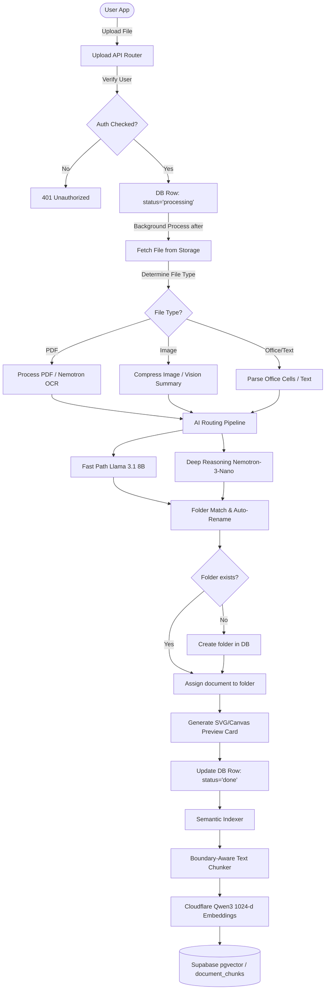
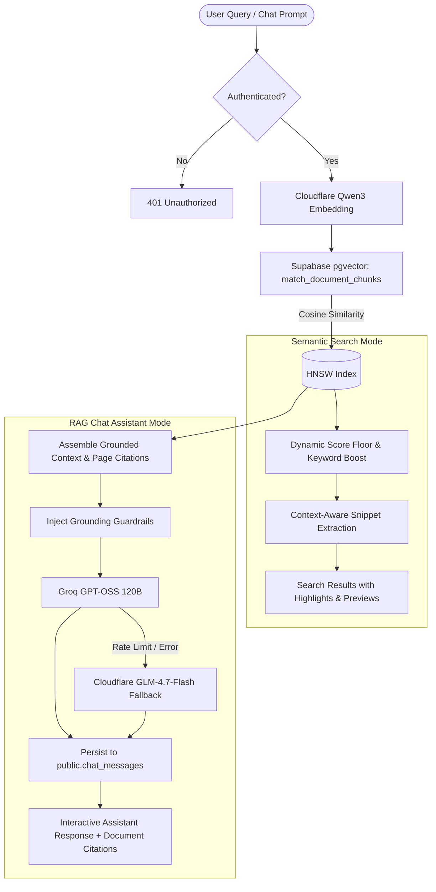

# 📄 PaperWait

<div align="center">

[](LICENSE)
[](https://nextjs.org/)
[](https://www.typescriptlang.org/)
[](https://supabase.com/)
[](https://build.nvidia.com/)
[](https://developers.cloudflare.com/workers-ai/)
[](https://groq.com/)

**"Because waiting to find it isn't an option."**

*A premium, secure, and AI-powered document intelligence safe with autonomous organization, semantic vector search, and grounded RAG document chat.*

### 🌐 [paperwait.me](https://paperwait.me)

### 🎥 [Watch Product Demo](https://drive.google.com/file/d/1K95xMwCEcmCGVs2hF9aCWnMDlrArQdOy/view?usp=sharing)

[Key Features](#-key-features) • [System Architecture](#-system-architecture) • [AI & Search Pipeline](#-ai--search-pipeline) • [Environment Configuration](#-environment-configuration) • [Database Setup](#-database--storage-setup) • [Security Spec](#-security-specifications)

</div>

---

## 🌟 Key Features

- 💬 **RAG AI Document Assistant**:
  - Conversational Q&A grounded strictly in the user's private document vault.
  - Generates verifiable citations with document names and page numbers (e.g., `[From "tax_return_2025.pdf", Page 2]`).
  - Strict anti-hallucination guardrails and structured data synthesis (clean financial bullets and comparison tables).
  - High-speed primary inference via Groq (`openai/gpt-oss-120b`) with automated fallback to Cloudflare Workers AI (`@cf/zai-org/glm-4.7-flash`).
  - Persistent, synchronized chat history per user stored in Supabase with Row Level Security.
- 🔍 **Vector Semantic Search**:
  - Natural language search across document contents, concepts, and metadata.
  - Powered by Cloudflare Workers AI 1024-dimensional embeddings (`@cf/qwen/qwen3-embedding-0.6b`).
  - Sub-millisecond similarity retrieval powered by PostgreSQL `pgvector` with HNSW cosine indexes.
  - Hybrid search architecture: combines vector cosine similarity, title/content keyword boosting, and dynamic precision thresholding.
  - Interactive UI with instant keyword mark highlighting, contextual snippet windows, and thumbnail previews.
- ⚡ **Multi-Format Ingestion & Processing**:
  - Seamlessly ingests PDFs, images (PNG, JPEG), Word docs (`.docx`/`.doc`), Excel spreadsheets (`.xlsx`), PowerPoint slides (`.pptx`/`.ppt`), CSV, and TXT files.
  - High-throughput OCR with Nemotron NIM extraction and multi-page text preservation (`--- Page N ---`).
  - Automatic background vector indexing immediately upon document processing completion.
- 🤖 **Ensembled Multi-Model AI Routing**:
  - **Llama 3.1 8B**: Evaluates fast-path classification for receipts, invoices, and utility bills.
  - **Nemotron-3-Nano Reasoning**: Executes deep taxonomy reasoning, tax forms, academic transcripts, and entity extraction.
  - **DeepSeek V4 Flash**: Crafts human-readable 1-sentence summaries and descriptions.
  - **Llama 3.2 11B Vision**: Interprets photo uploads, scans, and visual-only documents.
- 📁 **Smart Folder Match & Auto-Creation**:
  - Intelligently maps document context to user folder hierarchies.
  - Matches existing folders through substring and Levenshtein distance metrics or dynamically auto-provisions organized directories.
- 🖼️ **On-Demand Visual Previews**:
  - Automatically extracts PDF cover pages, resizes image thumbnails, and generates high-fidelity SVG/Canvas cards for text and spreadsheets.
- 🔒 **Enterprise-Grade Security & Authentication**:
  - Password recovery and reset flow with encrypted magic tokens.
  - Strict Row Level Security (RLS) across all tables (`documents`, `folders`, `document_chunks`, `document_index_status`, `chat_messages`).
  - Isolated private Supabase Storage buckets preventing cross-tenant data leakage.

---

## 🏗️ System Architecture

### 1. Ingestion, Classification & Vector Indexing Pipeline



### 2. Semantic Search & RAG Chat Retrieval Pipeline



---

## 🧠 AI & Search Pipeline

| System Layer | Technology / Model | Dimensionality / Parameters | Role |
| :--- | :--- | :--- | :--- |
| **OCR Ingestion** | NVIDIA Nemotron OCR NIM | Specialized OCR | Multi-page text and document transcript extraction |
| **Visual Ingestion** | Llama 3.2 11B Vision | 11 Billion | Visual content comprehension for scans and images |
| **Fast Classification**| Llama 3.1 8B | 8 Billion | Sub-second classification for transactional documents |
| **Deep Reasoning** | Nemotron-3-Nano Reasoning | Reasoning | Entity extraction, tax forms, academic documents |
| **Summarization** | DeepSeek V4 Flash | Fast Generation | User-friendly 1-sentence summaries |
| **Vector Embeddings** | `@cf/qwen/qwen3-embedding-0.6b` | **1024 dimensions** | Dense semantic representation for chunks and queries |
| **Vector Indexing** | PostgreSQL `pgvector` HNSW | `m=16, ef=64` | Sub-millisecond approximate nearest neighbor search |
| **Primary RAG LLM** | Groq `openai/gpt-oss-120b` | 120 Billion | Ultra-low-latency grounded document synthesis |
| **Fallback RAG LLM**| Cloudflare `@cf/zai-org/glm-4.7-flash`| Resilient Fallback | Seamless automatic failover for high availability |

---

## ⚙️ Environment Configuration

To run PaperWait locally, copy `.env.local.example` to `.env.local` and configure your credentials:

```bash
cp .env.local.example .env.local
```

| Environment Variable | Description | Required |
| :--- | :--- | :---: |
| `NEXT_PUBLIC_SUPABASE_URL` | Public API URL of your Supabase project instance | **Yes** |
| `NEXT_PUBLIC_SUPABASE_ANON_KEY` | Client-side anonymous public key for Supabase API requests | **Yes** |
| `SUPABASE_SERVICE_ROLE_KEY` | Secret service role key (Required for secure background processing) | **Yes** |
| `NVIDIA_API_KEY_OCR` | NVIDIA API credential for the Nemotron OCR NIM | **Yes** |
| `NVIDIA_API_KEY_LLM` | NVIDIA API credential for Llama/Nemotron/DeepSeek models | **Yes** |
| `CLOUDFLARE_ACCOUNT_ID` | Cloudflare account ID for Workers AI embeddings and fallback LLM | **Yes** |
| `CLOUDFLARE_API_TOKEN` | Cloudflare API token with Workers AI permissions | **Yes** |
| `GROQ_API_KEY` | Groq Cloud API key for ultra-fast RAG chatbot inference | **Yes** |
| `GOTENBERG_URL` | Gotenberg document conversion service (Optional, defaults to local dev server) | *No* |

---

## 🗄️ Database & Storage Setup

Database migrations are located in the `supabase/migrations/` directory and should be executed in order:

### 1. Core Schema (`20260715000000_init.sql`)
- `public.folders`: User folders and hierarchies.
- `public.documents`: Stores document metadata, statuses, OCR transcripts, AI classifications, and folder relationships.
- Enforces user isolation via Row Level Security (`auth.uid() = user_id`).

### 2. Semantic Search & Vector Embeddings (`20261019000000_document_embeddings.sql`)
- Enables PostgreSQL `pgvector` extension.
- Creates `public.document_chunks` table storing 1024-dimensional vectors with chunk index, page numbers, and content fingerprints.
- Sets up an HNSW cosine index (`idx_document_chunks_embedding_hnsw`) with `m = 16, ef_construction = 64`.
- Creates `public.document_index_status` for tracking indexing progress, idempotency, and backfills.
- Provisions `public.match_document_chunks` stored procedure with `SECURITY INVOKER` to guarantee user isolation during vector retrieval.

### 3. Persistent Chat History (`20261019010000_chat_history.sql`)
- Creates `public.chat_messages` table storing conversation turns, roles (`user`, `assistant`), grounded document sources, and timestamps.
- Enforces strict RLS policies ensuring users can only read, insert, and delete their own conversation history.

### 4. Supabase Storage Policies
Create a private bucket named `documents` in Supabase Storage with path-based isolation:
```sql
CREATE POLICY "Allow users to read their own folder"
  ON storage.objects FOR SELECT
  USING ( bucket_id = 'documents' AND (auth.uid()::text = (storage.foldername(name))[1]) );

CREATE POLICY "Allow users to insert their own files"
  ON storage.objects FOR INSERT
  WITH CHECK ( bucket_id = 'documents' AND (auth.uid()::text = (storage.foldername(name))[1]) );
```

---

## 🚀 Running the Application

### 1. Installation
Install project dependencies:
```bash
npm install
```

### 2. Run Development Server
```bash
npm run dev
```
Open [http://localhost:3000](http://localhost:3000) in your browser.

### 3. Production Build
Verify TypeScript compilation and generate the production bundle:
```bash
npm run build
```

---

## 🛡️ Security Specifications

PaperWait has been engineered with security and user privacy at its foundation:
1. **Zero Secret Leakage**: No operational API keys, tokens, or credentials are hardcoded or tracked in version control. All credentials are strictly resolved through server-side environment variables.
2. **PostgreSQL Row Level Security (RLS)**: Every database table (`documents`, `folders`, `document_chunks`, `document_index_status`, `chat_messages`) has RLS enabled with explicit `auth.uid() = user_id` policies.
3. **Storage Boundary Enforcement**: Supabase Storage policies ensure users can only access objects residing in their own UUID folder prefix.
4. **Sanitized AI Prompts & Inputs**: User queries and extracted document content are safely delimited and sanitized before prompt injection to avoid prompt hijacking.
5. **Robust Git Configuration**: `.gitignore` strictly ignores local operational files (`.env*`, `scratch/`, build caches) while preserving example configuration templates (`.env.local.example`).

---

## 📄 License

This repository is licensed under the [MIT License](LICENSE).
